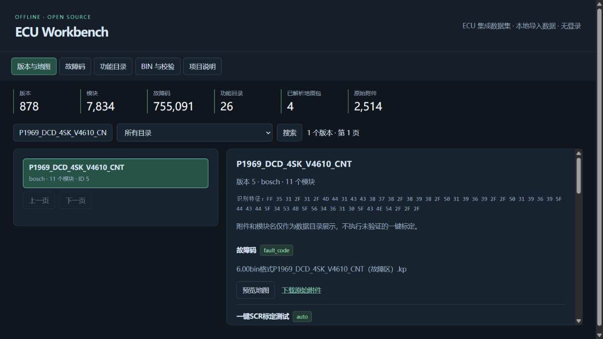
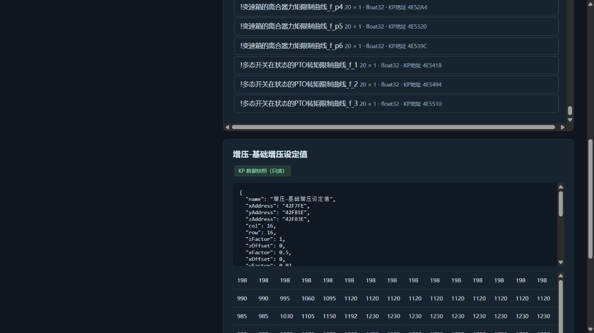
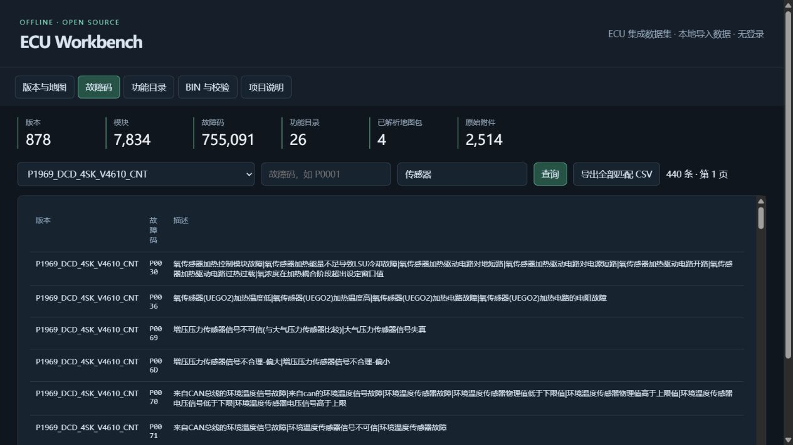
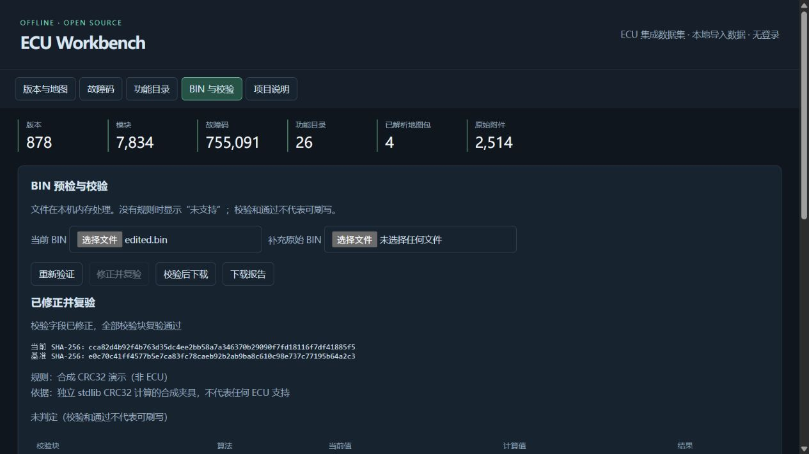

# ECU Workbench Open

无需卡密、账号或激活的开源离线数据工作台。Python 3.10+，仅使用标准库，可在 Windows / Linux / macOS 运行。

## 功能演示

### 版本与模块浏览

按版本或目录检索，查看模块信息并下载 KP / ECFG 原始附件。



### 地图只读预览

展示已解析 KP 快照的地址、维度、系数和数值表；截图中的数值不代表当前车辆 BIN 的实际值。



### 故障码查询

按版本、故障码或中文描述筛选，支持导出全部匹配结果为 CSV。



### BIN 校验与修正

以下截图使用项目自带的合成 CRC32 样本，展示关联原始基准、修正校验字段和复验流程，不代表真实 ECU 原厂校验支持。



## 启动

```sh
python app.py
```

打开 http://127.0.0.1:23010/ 。Windows 也可运行 `run.bat`。
已集成 `data/local` 的完整现有数据，启动后直接浏览。缺少该目录时，自动使用 `data/demo` 的合成示例。

## 稳定功能

- 版本、目录与模块浏览；不加载 BIN 也能查看数据。
- 故障码按版本、代码和描述查询，分页与 CSV 导出。
- 已解析地图 JSON 的元数据和表格预览，明确标注 KP 快照，不冒充 BIN 实际值。
- 原始 KP / ECFG 附件下载；未知布局的地图仅展示元数据。
- BIN 长度、SHA-256、字符串和版本特征预检。
- 两份 BIN 的真实字节差分，截断显示但统计全部差异。
- CRC32 / SUM16 / SUM32 规则校验、原始基准关联、修正后复验、报告与导出。

集成库包含 878 个版本、7,834 个模块和 755,091 条故障码；合成示例另行保留。**没有配置任何真实 ECU 的原厂校验算法。** 本地库里的功能名称是目录信息，不代表相应改写行为已经实现。

## 导入现有数据

导入已整理的本地数据包：

```sh
python import_data.py /path/to/ecu-data.zip
python app.py
```

也可从现有安装数据目录与已解析地图目录导入：

```sh
python import_data.py /path/to/resources/data --maps-dir /path/to/parsed-map-json
```

数据放入 `data/local`，随项目一并打包。目标目录已存在时拒绝覆盖，可用 `--destination` 指定新目录，再以 `python app.py --data-dir /new/directory` 启动。
数据库以 SQLite 只读模式打开。工具不依赖原后端读取地图；没有对应 JSON 的模块会明确显示尚未解析。

## 校验演示

进入「BIN 与校验」，加载 `data/demo/edited.bin`，补充 `data/demo/original.bin`，点击「修正并复验」。
这是独立合成夹具；不要用演示规则处理实际车辆固件。具体规则格式见 docs/CHECKSUM.md。

## 本地服务边界

仅监听 `127.0.0.1`，没有登录或 Cookie，拒绝非本机 Host 与跨来源写入，不提供 CORS 放行。
BIN 在内存中处理，每个文件上限 64 MiB，最多保留 8 个会话，重启后清空。
个性化校验规则保存在 `state/`，不进入公开包。

## 许可证

工具代码及默认合成演示数据：MIT。第三方数据权利不因工具开源而改变，见 NOTICE.md 和 DATA_POLICY.md。
